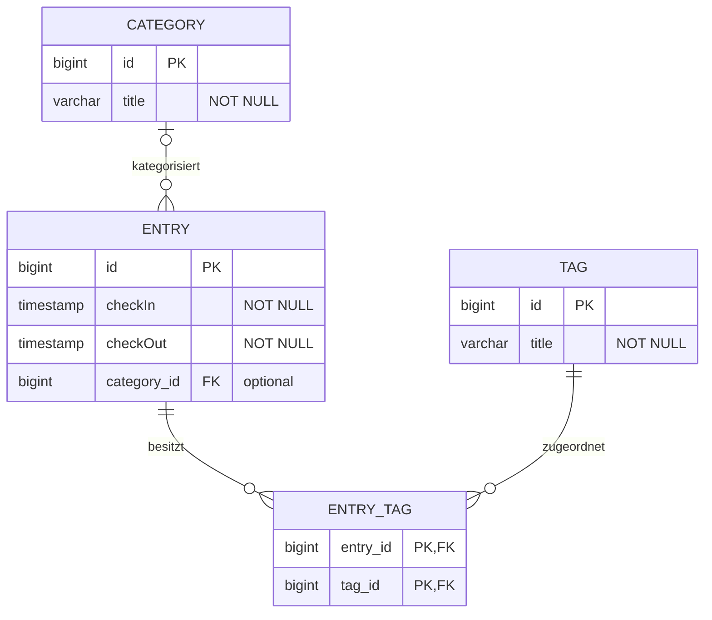

# Lösungsvorschlag Aufgabe 3.1 – Datenmodell erweitern

## Teilaufgabe 1: Erweitertes ERD



## Zwei Ausgabevarianten der REST-API

- `GET /entries` liefert `EntryDto` mit `categoryId` und `tagIds`.
- `GET /entry-details` liefert `EntryDetailDto` mit verschachtelten `CategoryDto` und `TagDto`. Diese enthalten jeweils ID und Titel, aber keine Rückverweise auf Entries.

Beide Endpunkte lesen dieselben Entries. Das Lesemodell `EntryDetailDto` benötigt keine eigene Datenbanktabelle. Die Umwandlung im `EntryDetailController` verwendet einfache Schleifen. POST und PUT unter `/entries` nehmen weiterhin IDs entgegen.

Beispiel einer Antwort von `GET /entry-details`:

```json
[
  {
    "id": 42,
    "checkIn": "2026-09-29T08:00:00",
    "checkOut": "2026-09-29T17:00:00",
    "category": {"id": 1, "title": "Projektarbeit"},
    "tags": [{"id": 2, "title": "Java"}]
  }
]
```

Ohne Kategorie ist `category` gleich `null`; ohne Tags ist `tags` eine leere Liste.

`GET /entry-details/{id}` liefert einen einzelnen Zeiteintrag als `EntryDetailDto`. Ist die ID unbekannt, antwortet die API mit HTTP 404.
