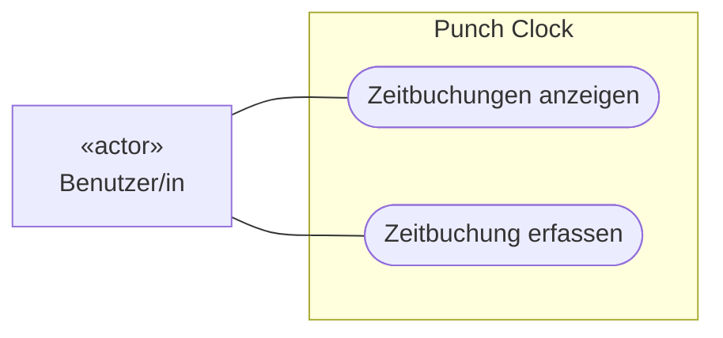
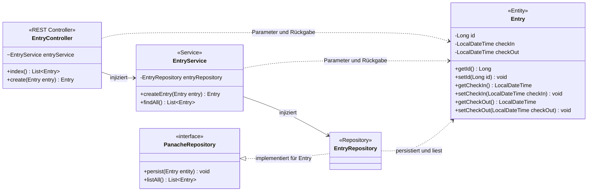
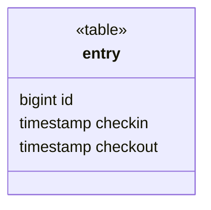
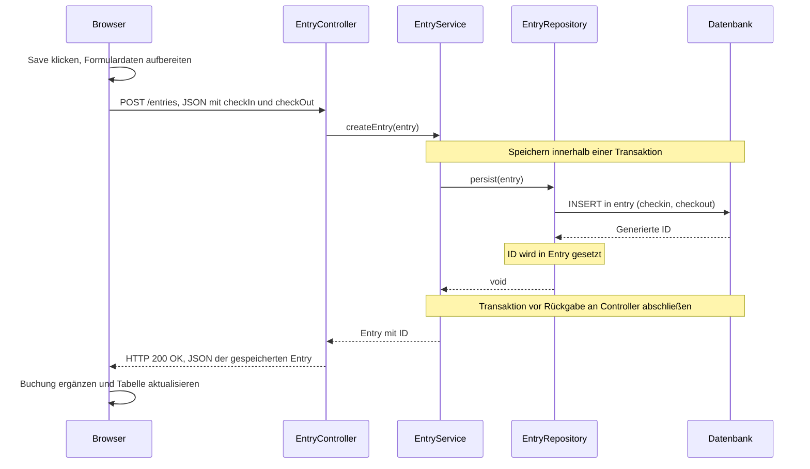
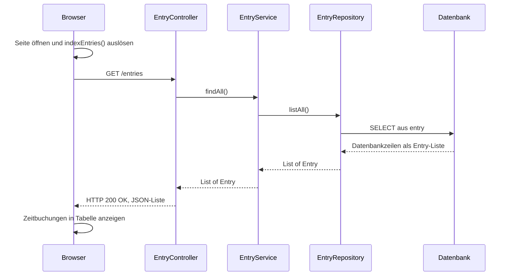

# Lösungsvorschlag: Aufgabe 1.4 – Übungsprojekt analysieren

## 2. UML-Anwendungsfalldiagramm
Mermaid unterstützt keine native UML-Anwendungsfalldiagramm-Syntax. Deshalb stellt ein Flowchart den Akteur, die Systemgrenze und die ovalen Anwendungsfälle dar. Die Verbindungen sind ungerichtete UML-Assoziationen.

## 3. UML-Klassendiagramm des Backends

## 4. Entity Relationship Diagram als UML-Klassendiagramm

| Java-Attribut | Erwartete PostgreSQL-Spalte | SQL-Typ | Einschränkungen |
| --- | --- | --- | --- |
| `id: Long` | `id` | `bigint` | Primärschlüssel, `NOT NULL`, durch die Datenbank generiert (IDENTITY) |
| `checkIn: LocalDateTime` | `checkin` | `timestamp without time zone` | `NOT NULL` |
| `checkOut: LocalDateTime` | `checkout` | `timestamp without time zone` | `NOT NULL` |

## 5. Sequenzdiagramme

### 5.1 Zeitbuchung erfassen

### 5.2 Zeitbuchungen anzeigen

